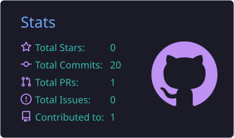
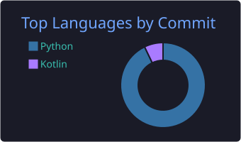

<div align="center">

# 안녕하세요, sheephero입니다 👋

<a href="https://github.com/sheephero">
  
</a>

데이터 분석과 머신러닝, 앱·웹 개발을 공부하며 직접 만들어 보고 있습니다.

</div>

## 🛠 기술 스택

<p align="center">
  
</p>

## 🔭 요즘 하는 일
- 실제 데이터를 수집·정제해 가격을 예측하는 머신러닝 프로젝트를 단계별로 기록하며 진행 중

## 📈 GitHub 통계

<p align="center">
  
  
</p>

<p align="center">
  
</p>

## ⏱ 코딩 시간 (WakaTime)

<!--START_SECTION:waka-->


**I'm an Early 🐤** 

```text
🌞 Morning                4 commits           ███░░░░░░░░░░░░░░░░░░░░░░   12.12 % 
🌆 Daytime                22 commits          █████████████████░░░░░░░░   66.67 % 
🌃 Evening                6 commits           █████░░░░░░░░░░░░░░░░░░░░   18.18 % 
🌙 Night                  1 commits           █░░░░░░░░░░░░░░░░░░░░░░░░   03.03 % 
```
📅 **I'm Most Productive on Tuesday** 

```text
Monday                   4 commits           ███░░░░░░░░░░░░░░░░░░░░░░   12.12 % 
Tuesday                  13 commits          ██████████░░░░░░░░░░░░░░░   39.39 % 
Wednesday                8 commits           ██████░░░░░░░░░░░░░░░░░░░   24.24 % 
Thursday                 0 commits           ░░░░░░░░░░░░░░░░░░░░░░░░░   00.00 % 
Friday                   0 commits           ░░░░░░░░░░░░░░░░░░░░░░░░░   00.00 % 
Saturday                 2 commits           ██░░░░░░░░░░░░░░░░░░░░░░░   06.06 % 
Sunday                   6 commits           █████░░░░░░░░░░░░░░░░░░░░   18.18 % 
```


 Last Updated on 27/11/2026 01:51:56 UTC
<!--END_SECTION:waka-->
